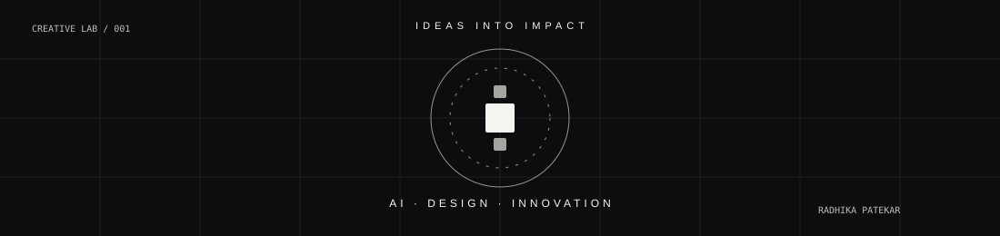

# Hi, I'm Radhika Patekar 👋

### AI & Data Science Engineering Student | Python Developer | Creative Problem Solver

I'm passionate about building practical technology solutions through Artificial Intelligence, Machine Learning, Computer Vision, Data Analytics and IoT.

I enjoy exploring new technologies, developing meaningful projects and combining technical knowledge with creative thinking.

---

---

## THE CREATIVE UNIVERSE

**Where Technology Meets Creativity.**

Building intelligent solutions, exploring creative ideas,  
and transforming imagination into meaningful experiences.

 

 

`ARTIFICIAL INTELLIGENCE` &nbsp; · &nbsp; `CREATIVE DESIGN` &nbsp; · &nbsp; `INNOVATION`

---

### About Me

- 🎓 B.E. in Artificial Intelligence & Data Science
- 💻 Interested in Python, Machine Learning and Computer Vision
- 📊 Exploring Data Analytics and Visualization
- 🤖 Interested in AI, IoT and intelligent systems
- 🎨 Passionate about creative design and innovative ideas
- 🌱 Always learning and building new things

---

### Technical Skills

**Programming:** Python, SQL, HTML, CSS

**AI & Machine Learning:** TensorFlow, Keras, PyTorch, OpenCV, YOLOv8

**Data Analytics:** Pandas, NumPy, Matplotlib, Excel, Power BI, Tableau

**Databases:** MySQL, MongoDB

**Core Concepts:** OOP, DBMS, Operating Systems, Data Visualization

---

### Featured Projects

| Project | Description |
|---|---|
| Face Mask Detection | Real-time face mask detection using computer vision |
| Emotion Detection System | Facial emotion recognition using deep learning |
| Bus Route Finder | Database-driven bus route search system |
| Intelligent Fault Detection using IoT | IoT-based electrical fault monitoring system |
| SARA Project Hub | AI-powered academic project repository and recommendation platform |

---

### Currently Exploring

- Artificial Intelligence & Machine Learning
- Computer Vision
- Data Analytics
- Innovative technology solutions

---

### My Approach

**Learn. Experiment. Build. Improve.**

I believe technology becomes meaningful when it solves real-world problems.

---

*Thanks for visiting my GitHub profile!*
